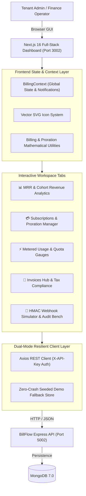

# BillFlow Dashboard 💳⚡

> Modern Next.js 16 SaaS subscription billing, dynamic proration calculator, metered consumption tracker, itemized invoice state machine, and HMAC webhook audit portal.

[](https://github.com/Jeevan-a10/billflow-dashboard/actions/workflows/ci.yml)
[](https://nextjs.org/)
[](https://react.dev/)
[](https://tailwindcss.com/)
[](tests/)
[](https://opensource.org/licenses/MIT)

---

## 🏗️ System Architecture



---

## ⚡ Core Features

### 1. Executive MRR & SaaS Metrics Analytics
- **Hero KPI Cards**: Monthly Recurring Revenue (**MRR**), Annual Run Rate (**ARR**), Active Subscribers, and 30-Day Cohort **Churn Rate** (< 3% Top-Decile benchmark).
- **Unit Economics**: Average Revenue Per User (**ARPU**) and Customer Lifetime Value (**LTV**).
- **Contract Intervals**: Monthly vs. Annual (-15% discount) distribution bar gauges.
- **Plan Breakdown**: Visual breakdown across Starter ($29/mo), Professional ($99/mo), and Enterprise ($299/mo) tiers.

### 2. Interactive Mid-Cycle Proration Engine
- **Live Mathematical Quote Preview**: Instant calculation of unused credits from the old plan fraction and prorated charges for the new plan fraction.
- **Seat Multipliers**: Dynamically adjusts multi-seat team pricing in real time.
- **1-Click Upgrade Execution**: Automatically commits plan upgrades to the backend API and generates itemized prorated invoices.

### 3. Real-Time Metered Consumption & Quotas
- **Consumption Gauges**: Live visual tracking of API requests, storage (GB), and compute runtime against subscription allowances.
- **Overage Calculations**: Automatically projects tiered overage costs when consumption exceeds plan limits.
- **High-Throughput Ingestion**: Dispatches usage records with idempotency key deduplication to prevent accidental double-billing.

### 4. Itemized Invoicing & Regional Taxation
- **Full Invoice Lifecycle**: Filter and manage invoices across `draft` ➔ `open` ➔ `paid` ➔ `void` states.
- **Regional Tax Calculation**: Displays tax calculations across US State tax (CA/NY), UK/EU VAT, and India GST.
- **Export Engine**: 1-click downloads for RFC 4180-compliant CSV invoice ledgers and JSON snapshot backups.

### 5. Cryptographic Webhook Test Bench & Audit Stream
- **Interactive Simulator**: Dispatches simulated Stripe-compatible payment events (`payment_intent.succeeded`, `payment_intent.payment_failed`, `customer.subscription.deleted`).
- **HMAC-SHA256 Signature Inspector**: Displays the computed `x-signature` header and payload body.
- **Real-Time Audit Log**: Chronological audit trail of received webhook events with delivery statuses and timestamps.

### 6. Zero-Crash Dual-Persistence & Fallback Mode
- Automatically connects to `billflow-api` on `http://localhost:5002`.
- If the backend is offline or during testing, seamlessly falls back to the built-in rich demo store, ensuring uninterrupted evaluation and demonstration.

---

## 🧪 Automated Testing

Runs on native Node.js test runner with zero dependencies:

```bash
npm test
```

```text
▶ BillFlow API Client & Data Contract Suite
  ✔ FALLBACK_DATA contains valid seeding contracts
  ✔ API Client exposes expected endpoint handlers
  ✔ plansAPI returns fallback plans when API is offline
  ✔ analyticsAPI returns fallback revenue metrics when offline
✔ BillFlow API Client & Data Contract Suite

▶ Billing & Proration Utility Tests
  ✔ formatCurrency formats integer cents into USD currency strings
  ✔ formatPercent formats numbers into percentage strings
  ✔ formatDate formats ISO dates or returns fallback
  ✔ calculateProrationQuote calculates exact credit and net charge for mid-cycle plan switch
  ✔ calculateProrationQuote correctly scales with seat increments
  ✔ calculateUsageOverage computes zero overage within allowance
  ✔ calculateUsageOverage computes tiered cost when exceeding allowance
  ✔ generateInvoiceCsv produces RFC 4180 escaped CSV ledger string
✔ Billing & Proration Utility Tests

ℹ tests 12
ℹ suites 2
ℹ pass 12
ℹ fail 0
```

---

## 🚀 Quick Start

### 1. Install & Run Locally

```bash
cd billflow-dashboard
npm install
npm run dev
```

Visit [http://localhost:3002](http://localhost:3002) in your browser.

### 2. Standalone Production Build

```bash
npm run build
npm start
```

### 3. Docker Deployment

```bash
docker build -t billflow-dashboard .
docker run -p 3002:3000 -e NEXT_PUBLIC_API_URL=http://localhost:5002 billflow-dashboard
```

---

## 📄 License

MIT © [Jeevan-a10](https://github.com/Jeevan-a10)
